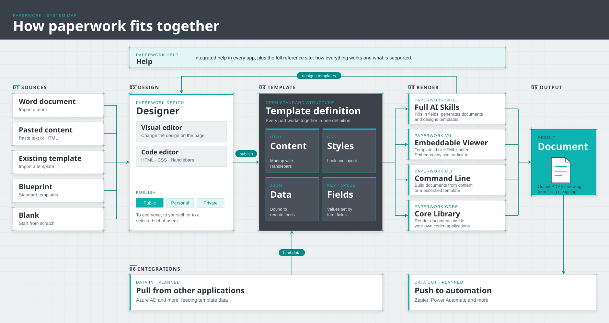
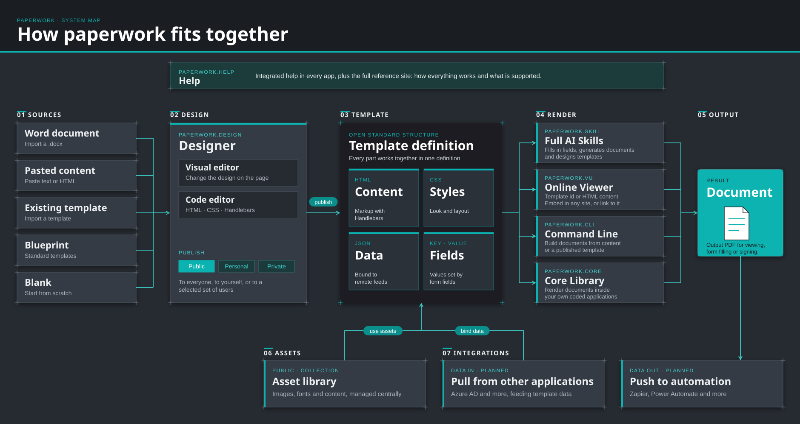

# How it all fits together
{: .no_toc }

Paperwork turns a template and some data into a document. You design the template once, publish it, and then the same template can be used by people in a browser, by your own code, by scripts and automation, and by your AI. Nothing is copied: everyone uses the one source.

<figure class="pw-map-figure">
  <a class="pw-map-link pw-map-light" href="/assets/system-map-light.svg" target="_blank" rel="noopener" aria-label="Open the system map full size in a new tab"></a>
  <a class="pw-map-link pw-map-dark" href="/assets/system-map-dark.svg" target="_blank" rel="noopener" aria-label="Open the system map full size in a new tab"></a>
</figure>

## Who does what

Developers provide the data and the integration. Designers and frontend developers build and publish the templates, in the HTML and CSS they already know. Each works in what they know, and neither is left owning the other's part: a wording, logo or layout change is a new version of the template, not a new release of your code.

## The ecosystem

| Step | Solution | What it does |
|---|---|---|
| **Design** | [Template Designer](/paperwork.design/) | Import or create a template, edit it visually or in code, add fields, data and assets, and preview the document as you go. |
| **Publish** | [Template Designer](/paperwork.design/publishing.html) | Check in a version and publish it publicly, just for you, or to a [collection](#collections) for your team. It gets an id that every other solution uses. |
| **View** | [Paperwork.Viewer](/paperwork.view/) | Open a published template, or your own content, in the browser. Embed it in a site or link directly, so end users can view, fill in and download. |
| **Code** | [Core Library](/paperwork.core/) | Generate documents inside your own .NET applications, from a template configuration and your own data, with the fluent builder. |
| **Automate** | [Command Line](/paperwork.cli/) | Build documents from published templates or your own files, straight from the command line, in scripts, pipelines and hooks. |
| **Delegate** | [AI Skills](/paperwork.skill/) | Let your AI find your templates, fill in fields, generate documents and design new templates for you, while you stay in control. |

All of them read the same template language, which is documented in the [Reference](/paperwork.core/reference/): HTML for the structure, CSS for the style, and `{{ }}` expressions to bind data.

## Collections

A collection is a shared space for a team's templates. It belongs to your organisation, and only a Publisher can create one. The Publisher decides who is in it, and what each member can do: fill in templates, build them, or publish them, up to what their licence allows. Members see the collection's templates. Apart from your portal's admins, nobody else does.

A collection's templates are only ever published to that collection, so the version your team uses is the one a Publisher chose. Someone can belong to several collections, for example one per team or per client, with a different role in each.

See [Roles and access](/roles/) for who can do what.

## A template is one file

Everything about a template, its layouts, styles, data, fields and meta data, is held together in a single JSON file: the [template configuration](/paperwork.core/template-config/). When you publish from the Designer, that is what is stored, and what the viewer, the library and the command line read.

That makes a template portable, which gives you two ways to work.

## Two ways to use a template

### Published

Publish the template, then use its id from anywhere. The examples below all use the same published invoice summary, `richard-prod:invoice-example`. Two of its fields are set in each example: the company's name (`name`) and the month (`invoiceMonth`, 1 to 12). Each field is set by the id it was given in the Designer.

Here it is, live. Use **Fill in** to change the company or the month.

<div class="pdf-container" style="margin-bottom:20px" data-pw-container="overview-invoice" data-pw-template="richard-prod:invoice-example" data-pw-ui="Minimal" data-pw-zoom="FullWidth" data-pw-actions="Download,FillFields,ViewCode" data-pw-height="520px"></div>

**In the Viewer.** Send a link. People open it, check the details, and download the PDF, on any device.

```text
https://paperwork.vu/richard-prod/invoice-example?name=Acme&invoiceMonth=3
```

**In a frame.** Put the same link in an iframe on a page you already have, such as an intranet or a client portal. Viewer options, such as `ui`, go in the same link.

```html
<iframe src="https://paperwork.vu/richard-prod/invoice-example?name=Acme&invoiceMonth=3&ui=Minimal"
        width="100%" height="800" title="Monthly invoice"></iframe>
```

**In your site.** Add the viewer to your own pages, and set the fields from your code.

```html
<div data-pw-container="invoice" data-pw-js-init></div>
<script src="https://paperwork.vu/er.js"></script>
<script>
  pw.show({
    name: 'invoice',
    template: 'richard-prod:invoice-example',
    fields: { name: 'Acme', invoiceMonth: '3' }
  });
</script>
```

**From the command line.** Make the document in a script, a scheduled job or a pipeline.

```bash
paperwork generate --template richard-prod:invoice-example \
  --field name=Acme --field invoiceMonth=3 \
  --output acme-march.pdf
```

**From your AI.** Ask for it in plain words:

> *Create the monthly invoice for Acme for March and email it to John.*

Claude finds the template, fills in the company and the month, and creates the PDF. It then sends it with the email tool you have connected: Paperwork makes the document but doesn't send it.

When you publish a new version, every link, frame, page, script and AI that uses the id has it straight away, with nothing to rebuild or redeploy. It is the best fit when the template changes more often than your code.

{: .note }
> **A template in a collection** works the same way, for the collection's members. They sign in, and you name the collection as well as the template: `collection: 'acme:finance'` with `pw.show`, or `paperwork login` and then `--collection acme:finance --template invoice-example` on the command line. Use a public template for frames on someone else's site, as signing in inside a frame can be blocked by the browser.

### Exported

If you would rather keep the template with your application, export it from the Designer as a file, and use that directly. There is no dependency on Paperwork being available when the document is made.

```csharp
using var config = File.OpenRead("invoice-template.json");

await factory.FromConfig(config)
    .WithData("model", invoice)
    .SaveAsync("invoice.pdf");
```

```bash
paperwork generate --config invoice-template.json --data model=invoice.json --output invoice.pdf
```

In the browser, the viewer can show a template your page provides, with no published id. Pass the layouts, styles and data from the exported file:

```javascript
pw.show({
  name: 'invoice',
  layouts: [{ name: 'main', content: invoiceHtml, format: 'html' }],
  styles:  [{ name: 'invoice.css', content: invoiceCss, format: 'css' }],
  datas:   [{ name: 'model', content: JSON.stringify(invoice), format: 'json' }],
  fields:  { name: 'Acme', invoiceMonth: '3' }
});
```

It is the best fit when the template should be versioned and released with your code.

## Using it by hand

You do not need the Designer to begin. The library and the command line both take plain HTML and CSS, with your data, and write a PDF:

```bash
paperwork generate --layout invoice.html --style invoice.css --data model=invoice.json --output invoice.pdf
```

You can move between these as a project grows: start with a file, bring it into the Designer to share and refine it, then publish it or export it again.

## Where to go next

- **See it work**: the [Library Quick Start](/paperwork.core/quickstart/quickstart_core) and the [Paperwork.Viewer](/paperwork.view/).
- **Design a template**: the [Template Designer](/paperwork.design/).
- **Share it with your team**: [Roles and access](/roles/).
- **Understand the file**: [Template Configuration](/paperwork.core/template-config/).
- **Look something up**: the [Reference](/paperwork.core/reference/) for HTML, CSS and expressions.
