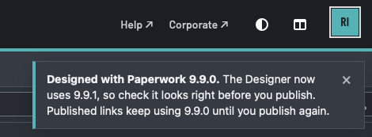

# Publish and share
{: .no_toc }

## Check out and check in

A template is saved in versions. To change one, **check it out**. While it is checked out nobody else can change it, but any version already published can still be used.

When you are happy, **check it in**. Checking in saves the version so that others who can edit the template can open it. You can keep the template checked out to carry on editing.

## Publish

Choose to publish the version when you check it in. It becomes the new standard version that everyone uses by default. You choose where to publish it:

| Publish to | Who can use it |
|---|---|
| **Public** | Anyone. It is listed in the published templates. |
| **Personal** | Only you, signed in. It is not listed. Needs an editor or publisher licence. |
| **A collection** | Private to the members of the collection. |

Public and Personal are for your own templates in My templates. A collection's template is only ever published to its collection.

Published templates are what the [viewer](/paperwork.view/) shows and what the [CLI](/paperwork.cli/) generates from with `--template`, `--personal` or `--collection`.

## Publish as a Blueprint

A Blueprint is a template that others can import and use as a starting point. Publish your template as one to share it. You can create a new Blueprint, or replace one you published before. Give it a title and a description, and up to ten tags, separated by commas, to help people find it.

## When the engine is newer

The engine is the part of Paperwork that lays out and writes the document. Each template you publish records the engine release it was published on, and the [Viewer](/paperwork.view/engine-version.html) always makes the document on that release. Published links do not change when Paperwork is updated.

The Designer always runs the latest engine. If a template was published on an older one, a notice appears in the editor, on the template's page and in the check-in dialog:

*"Designed with Paperwork 9.9.0. The Designer now uses 9.9.1, so check it looks right before you publish. Published links keep using 9.9.0 until you publish again."*

Check that the template still looks right, then publish it again to move it to the new engine. Until you do, anyone using the published links sees it as it was.

The [CLI](/paperwork.cli/) and [Paperwork.Core](/paperwork.core/) are not affected. They use the version you install.

## Embed and link

Every template has a unique reference you can use in the viewer, the CLI and your own pages. Choose to **embed** the template to see:

- the **template reference**, and for a collection, the **collection reference**, each with a button to copy it;
- a **link** that opens the template in the [viewer](/paperwork.view/links.html).

The reference is the value for `data-pw-template` in [Embed with HTML](/paperwork.view/embedding.html), and for `--template` in the CLI.

## Export

**Export** downloads a template as a file, which can be imported into another portal. You can set the title, the description, which version to export, and the file name.
