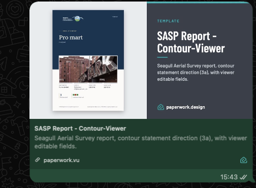

# Link to a document
{: .no_toc }

## What you'll do

Share a published template as a web address. You will fill its fields from the link and choose what the visitor sees.

## Before you start

- A published template, and its owner and name. You can find them in the Designer, from the embed option on the template. See [Publish and share](/paperwork.design/publishing.html).
- A public template opens for anyone. A template in a collection needs the visitor to sign in as a member of that collection. A personal template opens only for the person who published it, signed in.

## Steps

**1. Make the link.** A published template opens in the Viewer at an address made of its owner and its name:

```text
https://paperwork.vu/paperwork/invoice-sample
```

There are three shapes of link:

| Shape | Looks like | Use it for |
|---|---|---|
| Owner and template | `https://paperwork.vu/paperwork/invoice-sample` | A public or personal template. |
| Collection and template | `https://paperwork.vu/acme/hr/offer-letter` | A template in a collection. The collection `acme:hr` is written `acme/hr`. |
| Template id only | `https://paperwork.vu/Ab12Cd34Ef56Gh78Ij90` | The older form of link. See below. |

{: .note }
> **Older links keep working.** Before templates had an owner and a name, a template was found by one long id. If your intranet, emails or documents still hold a link like that, it still opens the template, and you do not need to change it. New links should use the owner and template form, which is easier to read and to recognise.

<div class="pw-shot"><span class="pw-shot-id">V32</span><span class="pw-shot-what">The More menu open in the Viewer with Copy link chosen.</span><span class="pw-shot-file">assets/images/viewer/v32-copy-link.png</span></div>

Open the template in the Viewer and choose **More** > **Copy link** to get its address, when that action is available. See [Viewer options](/paperwork.view/options.html).

**2. Fill fields from the link.** Add each field's id and value after a `?`, joined with `&`. The ids are the ones given to the fields in the Designer:

```text
https://paperwork.vu/paperwork/invoice-sample?name=Globex&invoiceMonth=3
```

{: .warning }
> **A link can set any field.** Anyone who has the link can change a value in it, including a value you would prefer to leave fixed, and that includes fields you only meant to be set in the Designer. Use a link to give a starting value. Do not rely on it to keep a value from being changed.

<div class="pw-shot"><span class="pw-shot-id">V16</span><span class="pw-shot-what">The invoice open for Globex and March, with the link in the address bar.</span><span class="pw-shot-file">assets/images/viewer/v16-link-with-values.png</span></div>

**3. Choose what the visitor sees.** Add the [viewer options](/paperwork.view/options.html) in the same way:

```text
https://paperwork.vu/paperwork/invoice-sample?ui=Minimal&zoom=FullWidth
```

| Parameter | Values |
|---|---|
| `ui` | `Default`, `Minimal` or `Sample` |
| `zoom` | `FullPage`, `FullWidth`, `Hidden` or a percentage such as `75` |
| `sidebar` | `Default`, `Closed`, `Thumbs`, `Outline`, `Properties` or `None` |
| `actions` | `All`, `None` or a list such as `Download,CopyLink` |
| `theme` | `light`, `dark` or a word of your own, added as a class |

## Link previews

When a link to a public template is shared in a chat or a social post, the preview shows the template's name and its first page.

- Previews exist only for a **public** template that is not in a collection. Personal and collection templates never have one.
- When you publish as Public, the publish step has an **Include share card** option. It is ticked by default.
- The card is made from the template's first-page preview when you publish, and replaced each time you publish again. Use sample data on the first page.
- The preview works for the Viewer's direct links, `https://paperwork.vu/{owner}/{name}`.

See [Publish and share](/paperwork.design/publishing.html).

{: .pw-img }

## Check it worked

Open the link in a private browser window. The document should show your values, and the toolbar should match the options you chose.

## Next

- [Embed with HTML](/paperwork.view/embedding.html), to put the same document on a page.
- [Viewer options](/paperwork.view/options.html), for the full meaning of each option.
