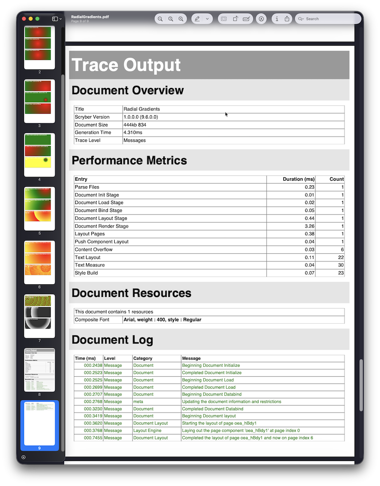

# Style guide
{: .no_toc }

Every content element the help site uses, in one place. Switch between light and dark with the toggle in the header, and resize the window to check the mobile layout.

## Headings and text

Body text is Barlow at 15px. A paragraph can include a [link](/paperwork.core/), `inline code`, **bold**, *italic*, <mark>highlighted text</mark>, and a keyboard hint such as <kbd>Ctrl</kbd> + <kbd>K</kbd>.

### Third level heading

#### Fourth level heading

##### Fifth level heading

###### Sixth level label

## Lists

- An unordered item with a teal marker
- Another item
  - A nested item
  - And another
- A last item

1. First ordered item
2. Second ordered item
   1. A nested ordered item
3. Third ordered item

Numbered steps, used on landing pages:

1. **Create a template** In the designer, import a Word document, paste content, use a blueprint, or start from scratch.
2. **Add data and fields** Bind data to a remote feed and add fields for the values users fill in.
3. **Publish** Publish publicly, personally to yourself, or privately to a selected set of users.
{: .pw-steps }

## Callouts

{: .note }
> **Note.** Use a note for supporting information the reader may want to know.

{: .important }
> **Important.** Something that matters for the next step.

{: .warning }
> **Warning.** Something that can go wrong, or that behaves differently from a browser.

{: .new }
> **New.** A feature added in a recent release.

{: .highlight }
> **Tip.** A shortcut or recommended approach.

> A plain blockquote, for quoted text.

## Tables

| Property | Type | Default | Description |
|----------|------|---------|-------------|
| `UseSystemFonts` | bool | `true` | Load fonts from system font directories |
| `FontSubstitution` | bool | `true` | Allow font substitution when the requested font is unavailable |
| `DefaultFont` | string | `"Sans-Serif"` | The default font family name |

| Property | Values | Support | Notes |
|----------|--------|---------|-------|
| `column-count` | `<integer>` or `auto` | Supported | |
| `column-rule` | `<width> <style> <color>` | Partial | Solid and dashed only |
| `grid-template-areas` | `<string>+` | New | |
| `filter` | | Not supported | Not rendered in PDF output |

Simple variant for short attribute lists:
{: .simple-note }

| Attribute | Type | Description |
|-----------|------|-------------|
| `lang` | string | Specifies the language of the document. |
| `title` | string | Sets the outline/bookmark title for the document. |
{: .simple }

## Code

```html
<html lang="en">
  <head>
    <title>Invoice #{{model.invoiceNumber}}</title>
    <link rel="stylesheet" href="invoice.css" />
  </head>
  <body>
    <!-- a comment -->
    <div class="header">{{model.companyName}}</div>
  </body>
</html>
```

```css
:root { --primary-color: #2c3e50; }
.invoice-table th {
  background-color: var(--primary-color);
  padding: 8pt;
}
```

```csharp
using (var doc = Document.ParseDocument("template.html"))
{
    doc.Params["model"] = data;
    doc.SaveAsPDF(stream);
}
```

```json
{ "model": { "invoiceNumber": "INV-1042", "items": [ { "quantity": 1, "total": 450.00 } ] } }
```

```bash
dotnet tool install -g Paperwork.CLI
```

## Buttons, tags and chips

[Primary](/paperwork.core/){: .btn .btn-primary } [Secondary](/paperwork.core/){: .btn } [Ghost](/paperwork.core/){: .btn .btn-ghost }

<span class="pw-tag is-new">New</span> <span class="pw-tag is-version">v6.2</span> <span class="pw-tag">PDF only</span> <span class="pw-tag is-muted">Experimental</span> <span class="pw-tag is-deprecated">Deprecated</span> <span class="pw-tag is-code">data-bind</span>

<a class="pw-chip is-selected" href="#">All <span class="pw-chip-count">24</span></a> <a class="pw-chip" href="#">Reference <span class="pw-chip-count">12</span></a> <a class="pw-chip" href="#">Learning <span class="pw-chip-count">9</span></a>

## Cards

<div class="pw-cards">
  <a class="pw-card" href="/paperwork.core/">
    <span class="pw-card-kicker">Paperwork.Core</span>
    <span class="pw-card-title">Core Library</span>
    <span class="pw-card-body">Render documents inside your own coded applications.</span>
  </a>
  <a class="pw-card" href="/paperwork.view/">
    <span class="pw-card-kicker">Paperwork.View</span>
    <span class="pw-card-title">Online Viewer</span>
    <span class="pw-card-body">View a template id or HTML content. Embed in any site, or link to it.</span>
  </a>
</div>

<nav class="pw-prevnext" aria-label="Previous and next">
  <a href="/paperwork.core/"><small>Previous</small><span>&larr; Core Library</span></a>
  <a href="/paperwork.view/"><small>Next</small><span>Online Viewer &rarr;</span></a>
</nav>

## Details and images

<details markdown="1">
<summary>An expandable section</summary>

Hidden content that appears when the summary is opened.
</details>



## Live example



---

That is every element. The horizontal rule above separates the end of the page.
